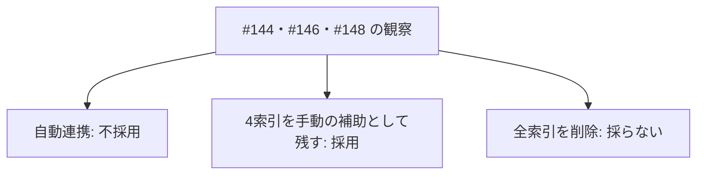

[原文（英語）](../../../for-agent/design-document/001-knowledge-index/conclude-pilot-adr.md)。食い違うときは原文が正本です。

# 知識索引の試作を完了し、自動連携は採用しない

状態: `accepted`（2026-11-02）

## 要点

- 試作を完了する。改良提案（`propose`）への自動連携は採用しない。
- 4つのローカル索引は、人や agent が必要なときに原典を探す手動の補助として残す。自動読み込み、定期更新、追加ページは持たない。
- 効果は未測定である。既知の領域では、索引が証拠の所在を示した。一方、接続の相対的な利益と保守費用は判断できない。
- 前の[計画](pilot-plan-adr.md)は、この結論に置き換えられた。この結論は、WikiSkill 全体に効果がないという意味ではない。
- 再検討は、実際の改良で探索の負担が繰り返し記録され、費用と保守時間を比べられる場合に、別の Issue で行う。

## 目的

Issue #144、#146、#148 の評価を踏まえ、試作を延長せず完了します。今採るものも決めます。

## アプローチ

| 確認                                  | 観察                                                                                                                                          | 解釈の限界                                                                                                                     |
| ------------------------------------- | --------------------------------------------------------------------------------------------------------------------------------------------- | ------------------------------------------------------------------------------------------------------------------------------ |
| 全文への索引追加（#144）              | 各条件2回。外部スコアは両条件とも16点満点で12点と14点。中央値の所要時間は索引なし31.210秒、索引あり57.128秒                                   | 検索方法は評価していない。引用から条件が分かり、採点は言い回しに寄った部分がある                                               |
| 6資料から最大2件を選んで回答（#146）  | 直接証拠の引用は索引なし1/4、索引あり4/4。得点は7/10対10/10で、差は直接証拠の引用3点による                                                    | 書き換えの質の改善は示さない                                                                                                   |
| 同じ試作の作業量（#146）              | 選択と回答の合計時間は182.613秒と120.899秒。入力の合計は10,365文字と11,912文字。条件の対応は原文に明記がない                                  | 1課題は索引ありで約3%遅い。入力は約15%増えた。各条件1回で、キャッシュ量も異なる                                                |
| 追加の2課題（D5・D6、事前に記録せず） | 直接証拠は両条件とも2/2回。選択の合計時間は35.418秒と46.161秒。入力は1,217文字と2,285文字。条件の対応は原文に明記がない。新しい見落としはなし | 関連概念は既存の索引にもあり、課題文が必要な情報を明示していた。カタログだけでも証拠に至れたため、自動連携の利益の証拠ではない |

## 限界・未確認

- 実費用、索引の保守時間、実際の改良提案の採用率、却下案の繰り返し提案数は未測定である。文書量やトークン数で代用しない。
- 追加確認は公開資料の確認で、最終評価や一般化の試験ではない。意味の質は別に採点していない。
- 4つの索引は網羅的な目録ではない。索引にない項目は、関連記録がないことを意味しない。
- Git の除外は、情報保護の代わりにならない。
- 静的レビューは Antigravity によるもので、独立した人のレビューでもホストでの実行確認でもない。
