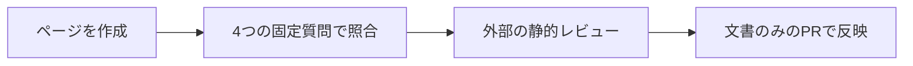

[原文（英語）](../../../for-agent/design-document/001-knowledge-index/pilot-plan-adr.md)。食い違うときは原文が正本です。

# 知識索引の試作計画

状態: `superseded`（2026-11-02）

## 要点

- #140 の段階的提案の第1段階として、設計記録と3〜5個の知識索引を作る計画である。
- 索引は既存の改良ワークフローや評価記録への入口である。改良提案（`propose`）への接続は、この試作の範囲外である。
- 対象は4ページ（各80行以内）と索引（60行以内）である。索引は未評価の試作で、実行時には読み込まない。
- 完了後、この計画は[結論 ADR](conclude-pilot-adr.md)に置き換えられた。

## 目的

開発の知見を後の改良で探せるかを試します。対象は4つです。文の機能、未解決の完了状態、具体化時に生じた根拠のない保証、上流機能と既存機能の重なりです。

## アプローチ

| 仮説                                     | 確認すること                                                       | 確認できないこと                         |
| ---------------------------------------- | ------------------------------------------------------------------ | ---------------------------------------- |
| H1: 索引から改良判断の証拠に至れる       | 4つの固定質問で、ページと原典の証拠の場所が一致する                | 索引なしより速いか、有用な提案が増えるか |
| H2: 知識の追加で誤った一般化を避けられる | 全ページに反例、仮説、評価の限界、採否の理由があり、証拠と照合する | 将来の更新で誤った知識が溜まらないこと   |

## 限界・未確認

- 上限は能動的な作業120分、静的レビュー最大240秒である。リンクの不整合、証拠を超えた主張、未公開の最終評価データの混入があれば保留する。
- 公開された人工例の評価と採否記録だけを使い、利用者の原文や機密情報は扱わない。Git の除外は機密性の代わりにならない。
- Claude Code、Codex、Antigravity での読み込みは確認していない。静的レビューは比較評価の代わりにならない。
