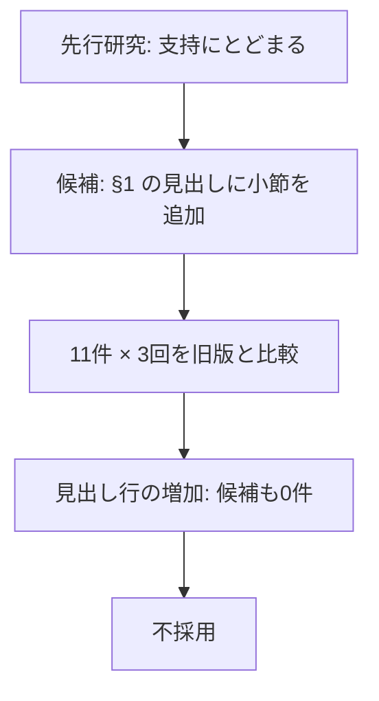

[原文（英語）](../../../for-agent/design-document/003-structure-rules/section-single-message-adr.md)。食い違うときは原文が正本です。

# 見出しや節ごとに内容を1つに限る規則は不採用とする

状態: `accepted`（2026-11-11）

## 要点

- 不採用である。候補は効果を示さなかったため、既存の §1 の規則を変えずに残す。
- 候補版でも、見出し行は増えなかった（主要12出力で0件）。
- 候補は、規則の例に合う s04 で見出しを増やした。過分割が起き、結びの言葉の対象がずれた。
- 意味の保持は両版とも pass 32、uncertain 1 である。ペア比較は実行に失敗したため、判断の根拠にしない。
- `measure.py` に見出しの指標を足さない。意味の混在は、スクリプトでは数えられないためである。

## 目的

部・章・節・小節・項目ごとに「内容を1つ」に限るというユーザー提案の効果を確かめます。既存の §1（論点が混ざっていないか、見出しで内容が分かるか）と重なるため、その差分を調べます。追跡は Issue #158 です。

## アプローチ

先行研究（段落の書き方、見出しの記憶研究、公共文書の指針）は、提案の支えにとどまります。LLM の改稿で効くことは示しません。多くは二次情報で、原典は確認していません。

| 基準                                | 旧版                 | 候補                 | 判定                                 |
| ----------------------------------- | -------------------- | -------------------- | ------------------------------------ |
| 1 意味の保持（33出力）              | pass 32、uncertain 1 | pass 32、uncertain 1 | 満たさない（候補の全件合格が必要）   |
| 2 見出し行の増加（主要4件・12出力） | 0件                  | 0件                  | 満たさない（3件以上の増加が必要）    |
| 3 「1つの内容」のペア比較           | 実行失敗             | 実行失敗             | 判定できない（反転側の判定が欠けた） |
| 4 過分割（対照9出力）               | —                    | —                    | 見出し数の条件は満たす。全体は未判定 |

## 限界・未確認

- 自作の11件は設計用の入力である。s04 は規則の例に合わせた入力のため、主要な集計から外した。
- 同じモデル系統（sonnet）で、人の採点はない。読み手の理解は測っていない。
- 同じ件の3回の出力は独立ではない。改善率や失敗率として一般化しない。
- 過分割の害は、実験で確かめられていない。仮説として扱う。
- 再検討するには、構造の作り直しを明示的に依頼するか、Mode A を対象にした別の実験をする。
