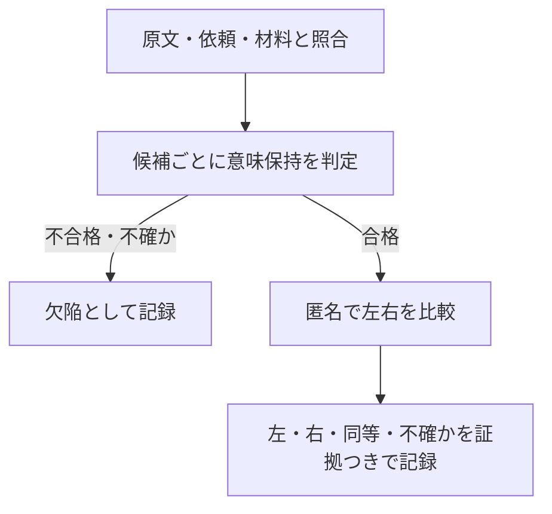

[原文（英語）](../../../for-agent/design-document/004-human-review-tooling/design-survey-document.md)。食い違うときは原文が正本です。

# 人による評価を改良の循環につなぐ調査

## 要点

- 推奨は、Mode B（既存文の編集）を対象とした、少人数向けのローカル評価画面である。
- 意味の保持（合否）と読みやすさは、別々に記録する。
- 既存の評価は、48件中46件が意味保持の合格で、判定は HOLD である。この合格率を読みやすさの改善率とみなさない。
- 保存するのは、問題の箇所、理由、任意の修正案である。
- ツールを導入しただけでは、文章の質が上がったとは示せない。

## 目的

調査日は 2026-10-16、対象は `26ec2c1d04da69409702f49408311c80af79174b` です。人による評価を、証拠を残す改良の循環につなぐ方法を調べました。統合の方針は[統合方針の要約](integration-document.md)にあります。

## アプローチ

| 候補                     | 判断                                                                                         |
| ------------------------ | -------------------------------------------------------------------------------------------- |
| ローカル HTML と標準 API | 初版の第一候補。割り当て、検証、再開は実装が必要                                             |
| Gradio                   | 採用済みなら再利用。Flagging だけでは割り当てや再開を扱えない                                |
| Streamlit                | Python の試作向け。保存と評価手順は別途設計する                                              |
| Label Studio             | 継続的な複数人利用や span 注釈が必要なときに優先                                             |
| Argilla                  | 既に使う場合に検討。公式 README は新機能の開発を計画していないため、新規の基盤には優先しない |
| SciPy / statsmodels      | 収集後の分析段階の任意依存。Skill 本体には入れない                                           |

## 限界・未確認

- 効果は人による研究で示されていない。既存の48件の評価は、独立した人の確認ではなく、48文書の研究でもない。
- 評価者の人数、専門性、対象文書は未定である。作業時間の見積もり（24〜40文書、評価者2〜3人で約4〜20人時）は、1組5〜10分と仮定した概算である。
- 30件で約±18ポイント、100件で約±10ポイントの区間は、独立な二項近似による概算である。
- ローカル HTML の日本語操作、再開時の保存、ネットワーク遮断時の動作は未確認である。
- 設計の方向性に対する主観的な確信度は 0.8 である。校正された確率ではない。
- 実装、配備、人による調査、テストの再実行は行っていない。
