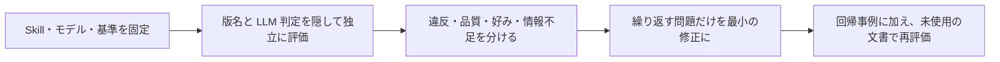

[原文（英語）](../../../for-agent/design-document/004-human-review-tooling/integration-document.md)。食い違うときは原文が正本です。

# 人による評価ツールを既存の Skill に統合する

## 要点

- 既存の仕組みは、モデルによる意味保持の採点と、機械的な候補検出が中心である。
- 人が原文、依頼、材料を読み、読みやすさと意味の損失を別々に記録する入口を追加する。
- 既存の `run.json` を読み取り専用で入力し、評価結果は別ファイルに JSON で保存する。
- 既存評価には、「広げないようにします」が「広げないでください」に変わった失敗がある。
- 評価ツールを入れるだけでは、Skill は改善しない。反復できる事例にし、未使用の文書で確かめる必要がある。

## 目的

確認日は 2026-10-16、対象は `26ec2c1d04da69409702f49408311c80af79174b` です。既存の評価と Skill の契約を確かめ、人による評価を加える最小の方法を示します。詳しい調査は[調査の要約](design-survey-document.md)にあります。

## アプローチ

| モード | 契約と意味保持                           | 人が見る品質                       | 避ける誤った評価                                           |
| ------ | ---------------------------------------- | ---------------------------------- | ---------------------------------------------------------- |
| A      | 依頼・材料との一致、根拠のない追加       | 読者の疑問への答え、構成、自然さ   | 原文との一致や短さだけで成功とみなす                       |
| B      | 条件、否定、主体、数量、文の機能、時制   | 主述・修飾の明確さ、読み返しやすさ | 変更が多いほど高い点を付ける。品質点で意味の変化を相殺する |
| C      | 改行だけが挿入されたかを機械的に確かめる | 話題の区切り、読みの流れ           | 語の置換を評価する                                         |
| D      | 操作、既存文の保持、視点・知識・開示     | 文体、会話、リズム、意図しない混乱 | 一般文書の短縮、結論先行、比喩の削除を当てはめる           |

MVP は `tools/` に開発用 CLI を追加し、標準ライブラリで生成したローカル HTML で評価します。保存する記録は、課題、割り当て、注釈の3種類です。既存の生成・採点 CLI とスキーマ、`skill/` と配布の仕組みは変更不要です。

## 限界・未確認

- 評価者の人数、専門性、対象文書は未定である。一般の読者を代表すると扱う根拠はない。
- このリポジトリには、独立した人の評価、理解度の課題、読む時間の測定がなかった。この結果は確認したファイルの範囲に限られる。
- 外部サービスの費用、共有の範囲、運用の負担は調査の範囲外である。
- 新しい UI の実装、テスト、実ブラウザでの確認は行っていない。「X%の改善」や「Y時間の節約」の根拠はない。
