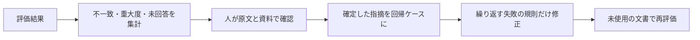

[原文（英語）](../../for-agent/implementation-plan/001-next-improvement-plan.md)。食い違うときは原文が正本です。

# 評価ツールの次の改良計画

## 要点

- 次の実装は P0 の2項目に限定する。不一致・重大度・未回答の集計と、確定した指摘の回帰ケース化である。
- 既存の評価画面と保存形式を再利用し、モデル、依存ライブラリ、サーバーは追加しない。
- 自動の指摘反映は採用しない。誤りや個人の好みを規則へ入れるおそれがあるからである。
- Issue #32〜#36 はこの報告に基づいて起票された。評価ツールのガイドに集計などの機能が記録されている。

## 目的

評価結果を、スキル改良で使える形にします。評価件数や指標を増やすだけでは、直す規則は決まりません。

## アプローチ

| 優先度 | 改良                                           | 工数（相対） | 期待される効果と機会費用                                       |
| ------ | ---------------------------------------------- | ------------ | -------------------------------------------------------------- |
| P0     | 不一致・重大度・未回答の集計                   | 小           | 危うい事例を見つけやすくする。理解度そのものは測らない。       |
| P0     | 確定した指摘の回帰ケース化                     | 小〜中       | 修正理由を回帰確認につなげる。人の確認と匿名化に時間がかかる。 |
| P1     | 人間とLLMの意味保存判定の比較                  | 中           | 自動判定を信頼できる範囲を示す。較正済みの人間データが必要。   |
| P1     | 別画面での理解度問題                           | 中〜大       | 読解の正答を直接測る。問題作成と読者確保が課題。               |
| P2     | 文書単位の差と信頼区間                         | 中           | 差の不確かさを示す。少数の標本の情報不足は解決しない。         |
| 保留   | 多人数向けサーバー、部分割当、全面的な自動改訂 | 大           | 現在の評価者数と回答量では費用に見合わない。                   |

## 限界・未確認

- 工数は相対的な評価であり、作業見積もりや改善率ではない。
- 研究は2026-10-16時点で、v0.10.0 が対象である。実装と実験は、どちらもしていない。効果の数値予測は根拠不足である。
- 利用者数、実際の回答、運用時間は測定していない。優先度の確信度0.8は、測定された確率ではない。
- 文献は一次情報・抄録・公式APIドキュメントを中心に確認した。論文の実験は再現していない。日本語の技術文書・業務文書で人間評価した研究はない。
