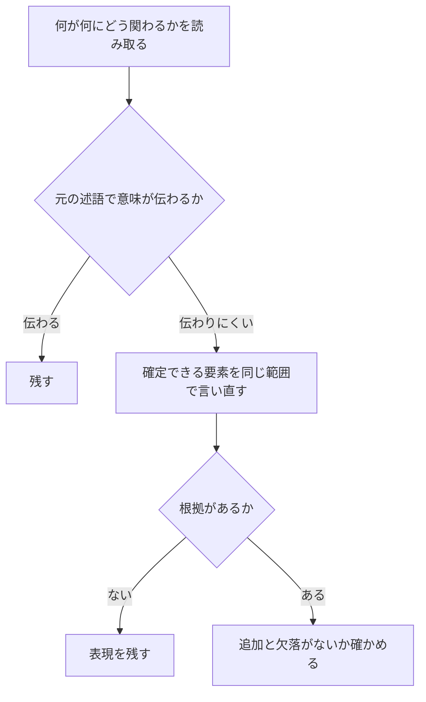

[原文（英語）](../../for-agent/implementation-plan/003-concretization-example-plan.md)。食い違うときは原文が正本です。

# 具体化の過剰な例を直す計画

## 要点

- 規則ファイルの「万能動詞」の例が、根拠のない対象限定や保証を促し、指示との矛盾を残していた。
- 修正後の手順は、まず根拠を確かめ、足りなければ表現を残す形にする。例7を参照する。
- 原文によると、その後、修正と比較評価が完了した。結果は `evals/concretization-result.md` にある。
- 結果は、指示の矛盾を取り除いたことと、品質への効果を分けて示す。品質への効果は未解決である。
- 禁止語の置換、自動検出器、依存ライブラリは採用しない。

## 目的

「万能動詞」の項にある、原文を超えて対象や保証を足す例の矛盾を直します。

## アプローチ

| 選択肢                             | 利点                                 | 残る問題                                   | 判断   |
| ---------------------------------- | ------------------------------------ | ------------------------------------------ | ------ |
| 誤った例だけを削除する             | 矛盾を最小の変更で除く               | 具体的な結果を求めるように読める           | 不十分 |
| 根拠の確認を先にし、例7を参照する  | 根拠の有無で分けられ、例が重複しない | 短い説明と動作確認が要る                   | 採用   |
| 禁止語、自動置換、検出器を追加する | 候補の表現を機械的に見つける         | 語の一致では適否や保証の変化を判断できない | 不採用 |

### 検証

- 優先度1は指示の整合性である。diff で、新たな対象、条件、評価の強さが増えていないかを見る。禁止語の一致だけでは意味の保持は確かめられない。
- 優先度2は6入力の小比較である。不明な対象の2件、資料のある同種の2件、自然な抽象表現と文字どおりの技術記述の2件を使う。同じモデルで、基準版と候補版を各3回、計36出力にする。
- 意味の保持を先に評価し、両方が通った組だけで表現の改善と自然さを別々に判定する。順序を入れ替えて再採点し、結果が食い違う組は未決とする。
- 候補に意味保持の `fail` や `uncertain`、欠落、モデルの不一致、評価監査の誤りがあれば、改善の結論を保留する。表現改善の勝ちが負けを上回らないか、自然さの負けが勝ちより多いときは、矛盾の除去だけを報告する。
- 優先度3は `tools/check_all.py` と `tools/package.py` の実行と、配布物の確認である。原文では設計時には未実行で、後に完了したと書かれている。

## 限界・未確認

- 具体化の矛盾は高い確度で存在した。ただし、局所修正の出力改善効果は完了した比較でも未解決である。
- この例だけが過去のモデルの失敗を起こしたとは確認していない。
- 長い文章の前段では、方針から依頼への変化、時系列から因果への変化が別の失敗として残る。
- 公開スキルは指示文として読み、動作は確かめていない。文献は抄録と書誌情報だけを確認し、論文の実験は再現していない。
