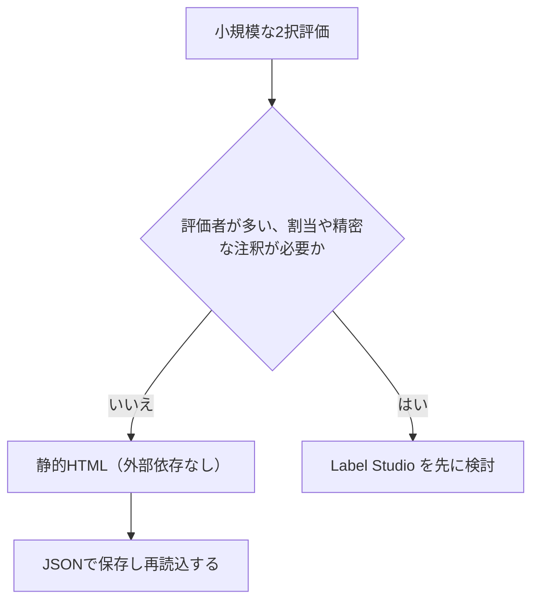

[原文（英語）](../../for-agent/requirement-definition-document/001-evaluation-tool-selection.md)。食い違うときは原文が正本です。

# 人手評価ツールの選定

## 要点

- 小規模な2択評価には、外部依存のないローカルHTMLが第一候補である。
- 評価者が多い、継続的な割当、精密なspan注釈が必要なら、Label Studio を先に検討する。
- Argilla は原作者が別プロジェクトへ移り、新機能を追加しない。機能一覧だけで選ばない。
- ローカル実行は外部接続なしを意味しない。初版はテキストをAPIへ送らず、外部CDNを使わない。
- UIと統計処理は分ける。最初は件数、勝敗、同等率、欠損、意味変化の件数を集計する。

## 目的

人手評価ツールを選ぶ前提を整理します。調査日は2026-10-16です。デスクリサーチであり、インストール、起動、日本語入力は試していません。評価の進め方は[人手評価の方法](002-human-evaluation-methods.md)の要約を参照してください。

## アプローチ

| 候補         | 確認した機能                   | 別途必要な作業                            |
| ------------ | ------------------------------ | ----------------------------------------- |
| 静的HTML     | ローカルファイルの読込と保存   | 評価フォーム、左右の割当、再開、集計      |
| Gradio       | Flagging でCSVへ記録           | 同等と判断不能の設定。ID管理は含まない    |
| Streamlit    | `download_button` で結果を保存 | 評価手順、永続保存、左右の対応            |
| Label Studio | Pairwise、Choices、Labels      | 同等はChoicesで明示。候補名は入力前に除く |
| Argilla      | 質問型を組み合わせられる       | 同等はLabelQuestionで表す。保守者を募集中 |

- 推奨の順序は、単独または少人数なら静的HTML、共有基盤があればLabel Studio、採用済みならGradioかStreamlitである。
- 最小版は精密なマウス選択を求めない。候補・文番号・問題の引用・問題の種類・望む変更を記録する。
- 集計の単位はソース本文である。同じ本文への複数の票を独立とみなさない。
- Gradio の Python 要件（>=3.10）は、本プロジェクトの範囲と一致しない可能性がある。
- Streamlit と Argilla には利用統計の送信があり、設定で無効にできる。
- 静的版では localStorage を唯一の保存先にしない。中間結果はJSONで書き出し、読み込めるようにする。

## 限界・未確認

- 日本語入力、段落をまたぐspan、数式、キーボードのみの操作、同時保存、ブラウザ差は未検証である。
- Label Studio Enterprise の盲検レビューと割当機能が Community Edition にあるかは未確認である。
- 最新安定版、依存ライブラリのライセンス、脆弱性、保守期間は監査していない。
- 統計ライブラリ（SciPy、statsmodels）の導入状況と、ブートストラップの実装は未確認である。数値分析は実行していない。
